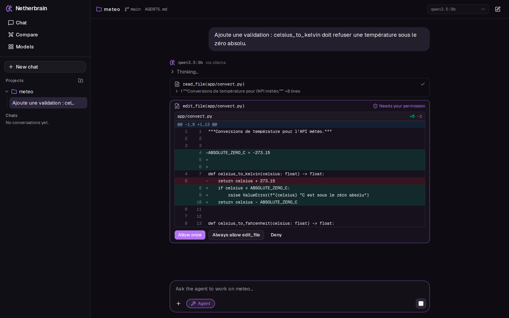

# Netherbrain

[](https://github.com/sma-ali/Netherbrain/actions/workflows/ci.yml)
[](LICENSE)


**Une interface de chat auto-hébergée pour des LLM locaux et distants, avec un agent de code qui
modifie vos projets uniquement avec votre accord.**



## Ce qu'il fait

- **Tous vos modèles au même endroit** : locaux (Ollama, llama.cpp) et distants (OpenRouter, Groq).
- **Un agent de code sous contrôle** : il lit et modifie un projet, et chaque écriture ou commande
  attend votre accord, avec le diff exact sous les yeux.
- **Des fichiers joints au chat** : documents, dossiers et images ; les longs documents sont
  fouillés par RAG.
- **Comparer et choisir un modèle** : 2 à 4 modèles côte à côte, un catalogue avec mesures réelles,
  et un conseiller qui recommande le bon modèle pour votre besoin.

## Architecture

```
Next.js ──SSE──> FastAPI ──> Ollama, llama.cpp (GPU local)
                    │    └──> OpenRouter, Groq (optionnels)
                    ├──> PostgreSQL + pgvector (historique, RAG)
                    └──> outils de l'agent ──> vos dossiers (sur accord)
```

| | Stack |
|---|---|
| Backend | Python 3.14, FastAPI, SQLAlchemy 2 async, Alembic, pytest, Ruff, uv |
| Base | PostgreSQL 18 + pgvector |
| Frontend | Next.js 16, React 19, TypeScript, Tailwind CSS 4, shadcn/ui, Vitest |
| Livraison | Docker Compose (images multi-étapes, non-root), GitHub Actions |

## Démarrage

Prérequis : Docker, et [Ollama](https://ollama.com) avec au moins un modèle (`ollama pull qwen3:8b`).

```bash
docker compose up --build
```

Puis ouvrir <http://localhost:3000>.

## Tests

```bash
cd backend && uv run pytest     # 270 tests, sans GPU ni réseau
cd frontend && npm test         # 48 tests
```

La CI relance lint, tests (sur un vrai PostgreSQL), build et images Docker à chaque push.

## Documentation

- [Guide d'utilisation](docs/guide.md) : projets, agent, fichiers joints, comparaison, catalogue
- [Développement](docs/developpement.md) : lancer sans Docker, clés d'API, tests, référence de l'API

## Licence

[MIT](LICENSE)
